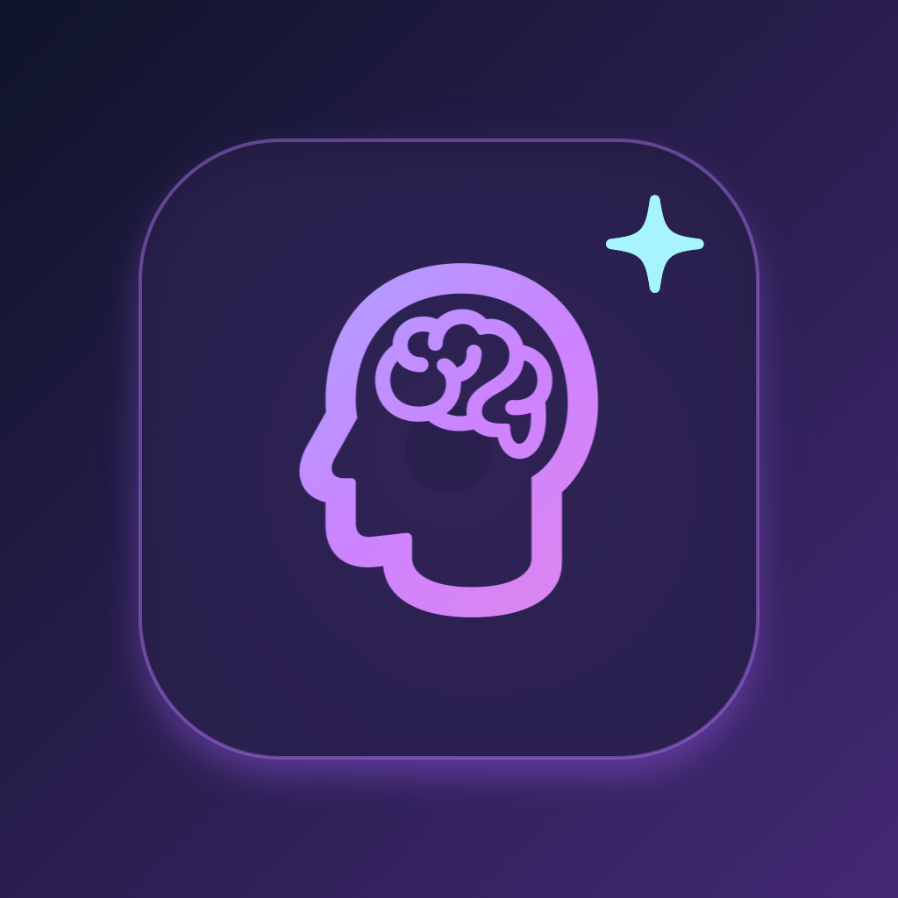

# 🧠 ReelMind iOS

<p align="center">
  
</p>

<p align="center">
  <strong>Your AI-powered second brain for social media reels, prompts, and tutorials.</strong><br>
  Capture, dissect, and organize technical knowledge directly from Instagram, TikTok, YouTube, and X.
</p>

<p align="center">
  
  
  
  
  
  
</p>

---

## 🌟 Highlights & Key Features

- **🌍 Native Bilingual Support (English & Spanish):** Powered by Apple's modern **String Catalogs (`.xcstrings`)** with 90+ translated keys. Includes **Adaptive AI Extraction** where Google Gemini automatically formats summaries, blueprints, and difficulty ratings in Spanish for Spanish-configured devices and English for international users.
- **📱 1-Tap Native Share Extension (`ReelMindShare`):** Dissect and ingest reels instantly from Instagram, TikTok, YouTube, or X without ever leaving the social network.
- **⚡ 100% Local-First Architecture:** Operates completely standalone on your device with an **actor-isolated in-memory cache** (`LocalVaultService`) providing microsecond read latencies and atomic disk persistence. Zero mandatory external servers. Zero telemetry. Zero trackers.
- **🤖 On-Device AI Extraction (Google Gemini):** Powered by direct REST API calls using **Structured Outputs** (JSON Schema enforcement) and secured via HTTP request headers (`x-goog-api-key`) to prevent query-string token leaks:
  - Exact copy-paste prompts & formula variations.
  - Step-by-step replication blueprints.
  - Detected AI tools & models (*Midjourney, Flux, Claude, ElevenLabs, Cursor*).
  - Difficulty ratings and estimated execution times.
- **🔐 Enclave Security & Keychain Protection:** API keys and sensitive tokens are encrypted using Apple's Security framework (`kSecClassGenericPassword` with `kSecAttrAccessibleAfterFirstUnlockThisDeviceOnly`). Zero plaintext storage in `UserDefaults`, plus strict URL scheme sanitization (`https`/`http` only).
- **🛡️ Apple App Store Review Compliant:**
  - Official Privacy Manifests (`PrivacyInfo.xcprivacy`) declaring approved reason `CA92.1` for user preferences and zero tracking.
  - Strict App Transport Security (ATS) hardening with `NSAllowsLocalNetworking: true` (no `NSAllowsArbitraryLoads`).
- **💡 Native Apple TipKit (iOS 17+):** Built-in contextual coaching introducing users to the Share Extension and quick workflows.
- **📳 Sensory Haptic Feedback:** High-fidelity tactile haptics (`.sensoryFeedback`) when copying prompts, toggling favorites, or switching statuses.
- **📦 Vault Export & Backup:** 1-click Markdown export via native `ShareLink` to AirDrop, iCloud Drive, or Notes, plus instant sample data restoration.

---

## 🏛️ Architecture Overview

The project is built on **Swift 6** with strict concurrency compliance, separating business logic, persistence actors, and observable state views:

```
ReelMind/
├── App/                  # App lifecycle, TipKit configuration & plists
├── Models/               # Immutable Codable & Sendable domain structures
│   ├── Reel.swift
│   ├── Folder.swift
│   ├── PromptVariation.swift
│   └── AppSettings.swift
├── ViewModels/           # @Observable & @MainActor state controllers
│   ├── ReelListViewModel.swift
│   ├── ReelDetailViewModel.swift
│   ├── IngestionViewModel.swift
│   └── SettingsViewModel.swift
├── Views/                # Modular, accessible SwiftUI views
│   ├── Dashboard/        # Dashboard, Reel cards & dynamic AI tool filter chips
│   ├── Detail/           # Breakdown, steps blueprint & prompt copy sections
│   ├── Ingestion/        # Manual URL ingestion sheet
│   ├── Vault/            # Prompt Studio & Ask Vault query interfaces
│   └── Settings/         # API Key configuration & Vault export
├── Services/             # Thread-safe actors & network drivers
│   ├── LocalVaultService.swift   # Actor-isolated JSON file & App Group storage
│   ├── GeminiService.swift       # Direct Google Gemini 2.5 Flash driver
│   ├── KeychainService.swift     # Security framework wrapper (kSecClassGenericPassword)
│   └── VaultRepository.swift     # Unified local-first repository
├── Tips/                 # Native Apple TipKit discovery rules
└── Resources/            # Assets catalog, PrivacyInfo.xcprivacy & Localizable.xcstrings

ReelMindShare/            # App Extension target (com.apple.share-services)
├── ShareViewController.swift
├── ShareView.swift
├── PrivacyInfo.xcprivacy
└── Localizable.xcstrings
```

---

## 🚀 Getting Started

### Prerequisites
- macOS Sonoma 14+ or Sequoia 15+
- Xcode 15.0+ or Xcode 16+
- [XcodeGen](https://github.com/yonaskolb/XcodeGen) (`brew install xcodegen`)

### Building the Project

1. **Clone the repository:**
   ```bash
   git clone https://github.com/Wacko87/reelmind-ios.git
   cd reelmind-ios
   ```

2. **Generate the Xcode project:**
   ```bash
   xcodegen generate
   ```

3. **Build and Run:**
   - Open `ReelMind.xcodeproj` in Xcode.
   - Select the `ReelMind` scheme and your target iOS Simulator or physical iPhone.
   - Press **Cmd + R** to run.

4. **Automated IPA Compilation:**
   ```bash
   ./scripts/build-ipa.sh
   ```
   Generates a signed release package (`build/IPA/ReelMind.ipa`) ready for sideloading or TestFlight/App Store submission.

---

## ⚙️ Configuration

ReelMind is designed to be functional immediately upon launch with pre-loaded onboarding reels.

To activate real-time AI ingestion from new links:
1. Open **Settings** inside ReelMind.
2. Tap **"Get Free Gemini Key"** (opens [Google AI Studio](https://aistudio.google.com/app/apikey) in 1 click).
3. Paste your key. It will be encrypted into your device's Secure Keychain.
4. *(Optional)* For advanced users with self-hosted backends, enable **"Self-Hosted Server Mode"** in Settings.

---

## 🔒 Privacy & Security

- **No Third-Party Trackers:** No Google Analytics, Firebase, or invasive tracking SDKs.
- **On-Device Encrypted Keychain:** Sensitive tokens never touch logs or disk in plaintext.
- **Privacy Manifest:** Compliant with Apple's May 2024 mandatory privacy declarations (`PrivacyInfo.xcprivacy`).

---

## 📄 License

Distributed under the MIT License. See `LICENSE` for more information.
